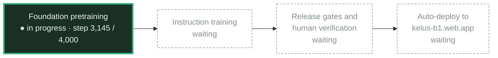
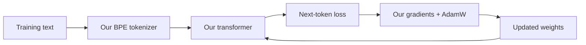

<!-- Sections between readme: markers are generated by `python3 -m kelus.readme`. Edit kelus/readme.py, not the generated text. -->
<!-- readme:hero -->
<p align="center">
  <a href="https://kelus-b1.web.app">
    <picture>
      <source media="(prefers-color-scheme: dark)" srcset="assets/readme/hero-dark.svg">
      
    </picture>
  </a>
</p>
<!-- /readme:hero -->

<h1 align="center">Kelus Model B1</h1>

<p align="center">
  <strong>A language model built from scratch, part of the Kelus IDE ecosystem.</strong><br>
  Our tokenizer. Our transformer. Our gradients. NumPy for the math.
</p>

<p align="center">
  <a href="https://kelus-b1.web.app"><strong>Try B1</strong></a>
  · <a href="https://github.com/KelusIDE/Kelus"><strong>Kelus IDE</strong></a>
  · <a href="MODEL_CARD.md"><strong>Model card</strong></a>
  · <a href="#quick-start"><strong>Quick start</strong></a>
  · <a href="#train-your-own"><strong>Train your own</strong></a>
  · <a href="#foundation-training"><strong>Training status</strong></a>
</p>

<p align="center">
  <a href="https://github.com/KelusIDE/KelusModelB1/stargazers"></a>
  <a href="https://github.com/KelusIDE/KelusModelB1/commits/main"></a>
  <a href="https://github.com/KelusIDE/KelusModelB1/issues"></a>
  <a href="LICENSE"></a>
</p>

<!-- readme:badges -->
<p align="center">
  <a href="https://kelus-b1.web.app"></a>
  <a href="https://kelus-b1.web.app/model/b1.json"></a>
  <a href="#results-and-roadmap"></a>
  <a href="#results-and-roadmap"></a>
  <a href="#foundation-training"></a>
</p>
<!-- /readme:badges -->

---

B1 is an open-source experiment in building a local chat and coding model from
random weights. The model engine, automatic differentiation, optimizer,
byte-pair tokenizer, training loop, and inference are implemented in this
repository. NumPy supplies array arithmetic; the model uses no pretrained
weights, AI framework, external tokenizer library, or remote model API.

**Build with it, learn from it, or make your own model.** The Python runtime
runs locally, and the browser version performs inference on your device.

> [!NOTE]
> **B1 is an experimental, narrow model.** The available v3 checkpoint handles
> practiced chat topics and short Python/JavaScript snippets. It still fails
> unfamiliar requests and cannot reliably create new programs or websites.
> B1 is a version name, not a billion-parameter claim. See the
> [measured results and limitations](MODEL_CARD.md).

## Meet the Kelus family

| Project | What lives there |
| :--- | :--- |
| **[Kelus IDE](https://github.com/KelusIDE/Kelus)** | The desktop editor: Electron, Svelte, Monaco, terminals, and coding-agent workflows. |
| **[Kelus Model B1](https://github.com/KelusIDE/KelusModelB1)** | This repository: the model, tokenizer, training pipeline, evaluations, and browser inference engine. |
| **[B1 web app](https://kelus-b1.web.app)** | Try the published B1 model in your browser. It shares Kelus accounts with the IDE. |

Inside Kelus IDE, open **Kelus Agent → B1** to chat with its bundled local B1
snapshot. Generated code blocks can be inserted into the editor with an Undo
boundary. The IDE bundle can be a different model version from the web app;
see the [IDE's B1 notes](https://github.com/KelusIDE/Kelus#kelus-model-b1-inside-the-ide).
B1 supplies that chat experience; the IDE's broader coding-agent and computer
control workflows have their own model configuration.

<details>
<summary><strong>For IDE contributors: update the bundled B1 snapshot</strong></summary>

With `Kelus` and `KelusModelB1` checked out beside each other, run this from
the **Kelus IDE repository**, after training and evaluating a checkpoint:

```sh
python3 scripts/bundle-b1.py ../KelusModelB1 ../KelusModelB1/checkpoints/b1-v3.best.npz
```

Rebuild the desktop app afterward. The bundler copies the inference code and
weights, records provenance, and omits optimizer state. Its default checkpoint
is an older B1 snapshot, so pass the intended checkpoint explicitly. Preserve
applicable license and notice files when distributing a bundle.

B1 in the IDE needs Python and NumPy, with `KELUS_PYTHON` available to select
an interpreter. It needs no API key or separately running B1 server. Inserting
code does not save or execute it, and editor files or screenshots are not
automatically attached to B1 prompts.

</details>

## Quick start

### Try it in your browser

**[Open kelus-b1.web.app →](https://kelus-b1.web.app)**

To serve the included browser model locally, use Python 3:

```sh
git clone https://github.com/KelusIDE/KelusModelB1.git
cd KelusModelB1
python3 -m http.server 8790 --bind 127.0.0.1 --directory site
```

Open **http://127.0.0.1:8790**. The repository includes the browser weights in
`site/model/`, so this route does not require training or NumPy. Use the hosted
site for configured account sign-in providers.

### Run the Python chat

Requires **Python 3.10+**, **NumPy**, and a B1 `.npz` checkpoint. From the
repository directory:

```sh
python3 -m venv .venv
source .venv/bin/activate
python3 -m pip install -r requirements.txt

# If you already have the v3 checkpoint:
python3 -m kelus.server --checkpoint checkpoints/b1-v3.best.npz
```

On Windows, activate the environment with `.venv\Scripts\Activate.ps1` in
PowerShell. Open **http://127.0.0.1:8765** for chat, or run the terminal client:

```sh
python3 -m kelus.chat --checkpoint checkpoints/b1-v3.best.npz
```

**A fresh clone does not contain Python checkpoints.** Train one using the
[next section](#train-your-own), or supply an existing checkpoint. The browser
export and the Python `.npz` checkpoint are different formats. On macOS,
**Start Kelus.command** starts the server with its default v3 checkpoint.

## The model, at a glance

| | Available B1 v3 | Foundation research track |
| :--- | :--- | :--- |
| Parameters | 431,424 | 8,691,840 |
| Transformer | 3 layers · width 96 · 4 heads | 6 layers · width 320 · 8 heads |
| Vocabulary | Own BPE · 1,024 tokens | Own BPE · 4,096 tokens |
| Context | 256 tokens | 1,024 tokens |
| Starting weights | Random initialization | Random initialization |
| Training material | Small synthetic chat/code curriculum | Python source/docs and MDN web-development documents |
| Status | Narrow chat and practiced snippets | Research track; not released as a coding assistant |

Both use rotary positions and tied input/output embeddings. The foundation
project has separate checkpoints and must complete instruction training and
coding evaluations before it can replace the available chat model. Follow
[FOUNDATION_TRAINING.md](FOUNDATION_TRAINING.md) for the recipe and
[AUTO_DEPLOY.md](AUTO_DEPLOY.md) for release gates.

### Foundation training

<!-- readme:foundation -->
<picture>
  <source media="(prefers-color-scheme: dark)" srcset="assets/readme/foundation-dark.svg">
  
</picture>

**Pretraining running: step 3,145 of 4,000 (78%).** 12.9M tokens seen; sampled validation loss 2.684 nats per token. Snapshot taken 2026-10-19 23:24 UTC; about 1.6 hours of this phase remained then.
Loss measures next-token prediction on held-out documents, not coding ability. Progress lives on the training machine; `python3 -m kelus.readme` copies it to [reports/foundation-progress.json](reports/foundation-progress.json).

<details>
<summary><strong>Release pipeline: where the next model stands</strong></summary>



Every stage must finish before the release watcher publishes. See [AUTO_DEPLOY.md](AUTO_DEPLOY.md).

</details>
<!-- /readme:foundation -->

### How B1 learns



The tokenizer learns recurring byte pairs from the training split. The
transformer predicts the next token, and our gradient engine and optimizer
update its weights. At inference time, a key/value cache reuses earlier
attention calculations; Python and browser engines are checked for parity.
Calculator and clock replies are labeled local helpers.

## Train your own

The v3 curriculum is already included. To train a new checkpoint:

```sh
python3 -m kelus.train --out checkpoints/my-b1.npz
python3 -m kelus.server --checkpoint checkpoints/my-b1.best.npz
```

Training is a separate compute job; the server command runs after it finishes.
To inspect progress from another terminal:

```sh
python3 -m kelus.progress
```

For an existing **foundation** research run:

```sh
python3 -m kelus.foundation_status --watch
```

The repository badges above show GitHub activity. Training progress is local
to the machine running the job.

<details>
<summary><strong>Training defaults, resume, and architecture options</strong></summary>

Defaults use `data/conversations-v3.jsonl`, 12,000 steps, batch 16, width 96,
3 layers, 4 heads, context 256, BPE vocabulary 1,024, rotary positions, tied
embeddings, dropout 0.1, AdamW learning rate 0.0015, weight decay 0.01, and
validation every 250 steps. Early stopping checks held-out validation loss.
The recorded v3 run took about 24 minutes on an Apple M4 CPU; its best
checkpoint was at step 10,000. Other hardware and data will take different times.

To regenerate the curriculum deterministically:

```sh
python3 data/make_v3.py
```

Each run saves `my-b1.npz` (latest) and `my-b1.best.npz` (lowest full validation
loss). Existing outputs are protected. Resume restores Adam state, the seed,
and sampling state, and checks dataset identity:

```sh
python3 -m kelus.train --resume checkpoints/my-b1.npz --out checkpoints/my-b1.npz --steps 1000
```

`--steps` means additional optimizer steps for this command. Warmup/cosine
scheduling restarts for each invocation. Ctrl+C retains the latest completed
checkpoint. **Train B1.command** resumes the default v3 checkpoint on macOS.

Options for a new model:

- `--positions learned|rope` sets positional encoding.
- `--tie-embeddings` / `--no-tie-embeddings` controls shared input/output weights.
- `--dropout`, `--width`, `--heads`, `--layers`, and `--context` set architecture.
- `--bpe-vocab 0` uses bytes; other supported sizes learn a local BPE vocabulary.
- `--init-from` starts a separate curriculum from a B1 checkpoint with fresh Adam state.

Older B1 checkpoints still load. See [MODEL_CARD.md](MODEL_CARD.md) for their
architecture and training differences.

</details>

<details>
<summary><strong>Conversation data format</strong></summary>

One JSONL record per conversation, alternating user and assistant:

```json
{"split":"train","messages":[{"role":"user","content":"hello!"},{"role":"assistant","content":"Hi! What would you like to build?"}]}
```

Use explicit `train` / `validation` splits for every record, or omit them
throughout to use a seeded 85/15 split. Include at least four distinct
conversations. Vocabulary learning only sees training examples.

An assistant message with `"supervise": false` remains context but is not a
training target, such as an incorrect earlier reply that the user corrects.
See [LANGUAGE_TRAINING.md](LANGUAGE_TRAINING.md) for reviewed multilingual
records, balanced sampling, and separate evaluation data.

</details>

## Results and roadmap

<!-- readme:results -->
The released model (`b1-v3.best`, 431,424 parameters) scores **158/199** on held-out wordings of its practiced topics. That benchmark measures familiar tasks: the separate new-program check scores **0/4**, and the website prompt passes **0/5** of its requested structure checks.

<picture>
  <source media="(prefers-color-scheme: dark)" srcset="assets/readme/results-dark.svg">
  
</picture>

<details>
<summary><strong>Score table</strong></summary>

| Group | Check | Passed | Rate |
| :--- | :--- | ---: | ---: |
| Held-out wording, practiced topics | Chat replies | 75/115 | 65% |
| Held-out wording, practiced topics | Concept explanations | 42/43 | 98% |
| Held-out wording, practiced topics | Code requests | 31/31 | 100% |
| Held-out wording, practiced topics | Two-turn chats | 10/10 | 100% |
| Held-out wording, practiced topics | Earlier wording suite | 12/15 | 80% |
| Regression checks | Context after earlier turns | 179/184 | 97% |
| Regression checks | Reported bug regressions | 5/5 | 100% |
| New tasks | New Python specifications | 0/4 | 0% |
| New tasks | Website structure checks | 0/5 | 0% |

</details>

Read [MODEL_CARD.md](MODEL_CARD.md) and [evaluation reports](reports/benchmark/) for the methods and limitations.
<!-- /readme:results -->

- [x] Implement the transformer, automatic differentiation, AdamW, and BPE.
- [x] Run local Python chat and matching browser inference.
- [x] Integrate a B1 snapshot into Kelus IDE.
- [x] Add a reproducible foundation-training pipeline and release gates.
- [ ] Complete foundation and instruction training, then pass coding evaluations.
- [ ] Validate broader programming-language and multilingual chat capability.

<details>
<summary><strong>Language targets: 23 coding languages and 7 chat language/script targets</strong></summary>

These are **requested training targets, not verified current capabilities**.

**Code:** Python, JavaScript, TypeScript, Java, C, C++, C#, PHP, Go, Rust,
Swift, Kotlin, Ruby, SQL, R, Scala, Perl, Dart, Lua, COBOL, PowerShell, Zsh,
and Bash.

**Chat:** English, Korean, French, Spanish, German, Simplified Chinese, and
Traditional Chinese.

The target registry and release checks are described in
[LANGUAGE_TRAINING.md](LANGUAGE_TRAINING.md). Inspect the registry with:

```sh
python3 -m kelus.curriculum --targets
```

</details>

## Contribute and verify

Contributions to the tokenizer, training performance, data quality,
evaluations, documentation, and IDE integration are welcome.
[Open an issue](https://github.com/KelusIDE/KelusModelB1/issues) with a
reproducible example or propose a focused pull request. Keep training and
evaluation data separate, preserve upstream credits, and report measured
results when making capability claims.

Run the unit suite with Python and NumPy; browser parity checks also need Node.js:

```sh
python3 -m unittest discover -s tests -v
```

The hero, badges, scores, and training status above are generated. After
evaluating or exporting a model, or to publish foundation progress from the
training machine, run `python3 -m kelus.readme` (or double-click
**Update README.command**) and commit the result. On GitHub, the README
workflow reruns it whenever reports or the exported model change.

<details>
<summary><strong>Checkpoint evaluations and browser account checks</strong></summary>

These model evaluations require the relevant locally trained checkpoints:

```sh
python3 -m kelus.benchmark --show-failures
python3 -m kelus.evaluate --out reports/b1-eval.json
python3 -m kelus.evaluate_repair --checkpoint checkpoints/b1-v3.best.npz --out reports/b1-repair.json
python3 -m kelus.code_readiness
```

The benchmark uses hand-written prompts and refuses prompts found in its
training splits. Code examples are assessed by a bounded AST interpreter;
generated code is not passed to `eval` or `exec`. Context checks separately
measure earlier-turn interference.

`tests/test_web.py` compares browser and Python behavior, including rotary
and learned positions, Unicode, code fences, and local helpers.
`tests/run_site_e2e.sh` exercises accounts against Firebase emulators; it
requires Chrome, Java, and the Firebase CLI and does not use real accounts.

</details>

<details>
<summary><strong>Browser deployment and account storage</strong></summary>

`site/b1.js` is the JavaScript inference engine. Export an evaluated Python
checkpoint before previewing or deploying:

```sh
python3 -m kelus.export_web --checkpoint checkpoints/b1-v3.best.npz --out site/model
python3 -m http.server 8790 --bind 127.0.0.1 --directory site
firebase deploy --only hosting:kelus-b1 --project kelus-ide
```

Use [AUTO_DEPLOY.md](AUTO_DEPLOY.md) for the gated foundation-model release
process. The site offers a reload when newer model weights are available.

Signed-out chats stay in memory. When signed in, transcripts are saved to the
user's Firebase account and sync across devices; inference still happens in
the browser. Chats are not used as training data. The site shares Kelus IDE's
Firebase project and supports email/password, Google, and GitHub sign-in.

Account code lives in `site/account.js`; the Firebase SDK entry is
`site-src/firebase.js`. Firestore rules are managed in the Kelus IDE repository.
Hosted domains must be authorized in Firebase Authentication.

</details>

## Explore the source

| Area | Start here |
| :--- | :--- |
| Tokenizer | [`kelus/tokenizer.py`](kelus/tokenizer.py) |
| Transformer and cached generation | [`kelus/model.py`](kelus/model.py) |
| Gradients and optimizer | [`kelus/tensor.py`](kelus/tensor.py) · [`kelus/optim.py`](kelus/optim.py) |
| Conversation training | [`kelus/data.py`](kelus/data.py) · [`kelus/train.py`](kelus/train.py) |
| Foundation corpus and pretraining | [`kelus/corpus.py`](kelus/corpus.py) · [`kelus/pretrain.py`](kelus/pretrain.py) |
| Chat behavior and local helpers | [`kelus/runtime.py`](kelus/runtime.py) · [`kelus/local_tools.py`](kelus/local_tools.py) |
| Evaluations | [`kelus/benchmark.py`](kelus/benchmark.py) · [`kelus/code_readiness.py`](kelus/code_readiness.py) |
| Python server and terminal chat | [`kelus/server.py`](kelus/server.py) · [`kelus/chat.py`](kelus/chat.py) |
| Browser inference and export | [`site/b1.js`](site/b1.js) · [`kelus/export_web.py`](kelus/export_web.py) |
| Curriculum generation | [`data/make_v3.py`](data/make_v3.py) |
| README figures and status | [`kelus/readme.py`](kelus/readme.py) |

## License and attribution


Copyright 2026 the Kelus Model B1 contributors. Original project materials
are licensed under [Apache-2.0](LICENSE). You may fork B1, build another AI
using it, modify it, and use it commercially. When redistributing covered
B1 material or derivatives, include the license, preserve the applicable
[NOTICE](NOTICE) and source credits, and mark modified files as required
by section 4. Removing required attribution violates those conditions.

Third-party materials retain their own licenses. See [LICENSING.md](LICENSING.md)
for model-weight scope, attribution examples, permitted forks, and the limits
of the credit requirement.
