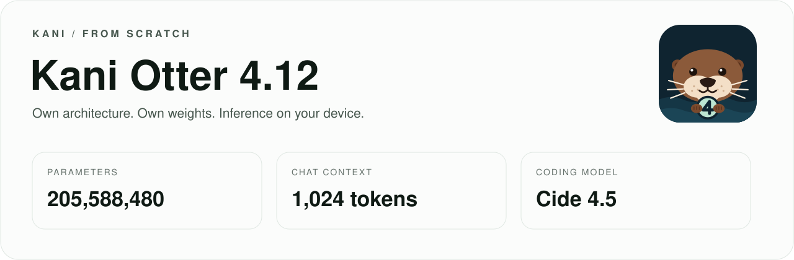

<!-- Sections between readme: markers are generated by python3 -m kelus.readme. -->
<!-- readme:hero -->
<p align="center">
  <a href="https://kelus-b1.pages.dev">
    <picture>
      <source media="(prefers-color-scheme: dark)" srcset="assets/readme/hero-dark.svg">
      
    </picture>
  </a>
</p>
<!-- /readme:hero -->

<h1 align="center">Kani</h1>

<p align="center">
  <strong>Our tokenizer. Our transformer. Our weights.</strong><br>
  A language-model project from Kelus, with browser, terminal, editor, and mobile clients.
</p>

<p align="center">
  <a href="https://kelus-b1.pages.dev"><strong>Try Kani</strong></a>
  · <a href="https://github.com/KelusIDE/KelusModelB1/releases/latest"><strong>Download Android</strong></a>
  · <a href="#quick-start"><strong>Run locally</strong></a>
  · <a href="#train-your-own"><strong>Train a model</strong></a>
  · <a href="https://github.com/KelusIDE/Kelus"><strong>Kelus IDE</strong></a>
</p>

<p align="center">
  <a href="https://github.com/KelusIDE/KelusModelB1/stargazers"></a>
  <a href="https://github.com/KelusIDE/KelusModelB1/commits/main"></a>
  <a href="LICENSE"></a>
</p>

<!-- readme:badges -->
<p align="center">
  
  
  
</p>
<!-- /readme:badges -->

Kani started as **Kelus Model B1**. Today this repository contains the Kani
Otter chat models, the Cide coding specialist, training and evaluation tools,
and the clients that run them. The text-model weights come from our own
training, starting from random initialization rather than another model's
pretrained weights.

The original CPU implementation uses **NumPy** and our own automatic
differentiation, optimizer, byte-pair tokenizer, and transformer. The newer
Mac GPU training path uses **MLX / Metal** for arrays and gradients. The
JavaScript inference engine runs locally, with a WebGPU path where supported.
The React and native clients have their own application dependencies; the
project is not dependency-free.

## Current releases

<!-- readme:releases -->
| Model | Role | Parameters | Context | Weights |
| :--- | :--- | ---: | ---: | ---: |
| [Kani Otter 4.12](site/models/otter-4-12/b1.json) | Default chat | 205,588,480 | 1,024 tokens | 206.4 MB |
| [Cide 4.5](site/models/cide-4-5/b1.json) | Coding specialist | 205,588,480 | 4,096 tokens | 206.4 MB |
| [Kani Seal 3](site/model/b1.json) | Smaller chat model | 8,691,840 | 1,024 tokens | 34.8 MB |

| Client | Version |
| :--- | :--- |
| Android / mobile source | 0.5.10 |
| Node.js CLI | 0.18.0 |
| VS Code extension | 0.17.0 |

[Download the Android app](https://github.com/KelusIDE/KelusModelB1/releases/latest) · [Published model snapshot](https://github.com/KelusIDE/KelusModelB1/releases/tag/models-2026-11-05)

Sizes describe the downloadable exports, not training checkpoints. Parameter counts and context windows describe the architecture, not benchmark performance.

The API has a separate release configuration: `kani-otter-4.3`, `cide-2`, `kani-seal-3`. It does not automatically follow the browser or CLI default.
<!-- /readme:releases -->

## What is included

| Part | Where | What it does |
| :--- | :--- | :--- |
| Browser app | [`web/`](web/), [`site/`](site/) | React interface, streaming replies, model switching, code blocks, local file/PDF helpers, optional search, and Kelus accounts. |
| Terminal client | [`cli/`](cli/) | Local Node.js inference, model switching, workspace inspection, and reviewed file proposals. |
| VS Code extension | [`vscode-extension/`](vscode-extension/) | Local streaming chat, model selection, and Copy / Insert actions for code. |
| Android and iOS | [`mobile/`](mobile/) | React + Capacitor clients, CocoaPods iOS project, and a GitHub-backed Android update channel. |
| Text models and training | [`kelus/`](kelus/), [`data/`](data/) | CPU and Mac GPU training, tokenizer tools, dataset generators, checkpoints, and evaluation code. |
| Model distribution | [`model-host/`](model-host/) | GitHub Release exports, pinned checksums, local download helper, and browser download Worker. |
| Developer API | [`api/`](api/) | API-key gateway and a separately hosted model backend. |
| Search service | [`search-worker/`](search-worker/) | Optional search and places requests; provider keys stay on the backend. |

Search results, calculators, document inspection, and workspace operations are
application tools around the model. They do not mean the weights learned every
fact or operation. Search requires a network connection; local inference can
continue with the required weights already downloaded.

## Quick start

### Open the web app

**[kelus-b1.pages.dev →](https://kelus-b1.pages.dev)**

The app downloads the selected model and generates text on your device.
Verified weights are cached when browser storage is available. A fresh model
selection, storage eviction, or private browsing can require another download.
WebGPU availability depends on your browser and device.

### Run the terminal client

Requires **Node.js 22+**. No Python, NumPy, or external model API is needed for
text inference with these JavaScript exports.

```sh
git clone https://github.com/KelusIDE/KelusModelB1.git
cd KelusModelB1
node model-host/download.mjs latest cide
node cli/kani.mjs
```

The download command installs Otter and Cide from the pinned GitHub model
snapshot, verifies file size and SHA-256, and reuses valid local copies. The two
exports total about **413 MB**. Model binaries are kept out of Git.

```sh
node cli/kani.mjs "Write a short paragraph about otters."
node cli/kani.mjs --build cide "Write a JavaScript function that groups an array by key."
```

Inside chat, `/model` lists builds, `/model cide` selects the coding specialist,
and `/new` clears the conversation. `/cide TASK` asks the specialist directly.
For a global `kani` command, run `npm link` in `cli/`.

`/files`, `/read`, `/search`, and `/analyze` inspect the current workspace.
`/draft` prepares a file proposal; `/apply` writes an approved proposal with
stale-file checks and a backup. See the [CLI guide](cli/README.md) for exact
commands, execution controls, and limits.

Published older exports can be installed with
`node model-host/download.mjs <model-id>`, such as `seal-3`. `--all` downloads
all exports in the catalog. Some historical build choices need local Python
checkpoints and are not included in that catalog.

### Serve the browser app locally

After cloning and downloading weights, use Python 3 as a static server:

```sh
python3 -m http.server 8790 --bind 127.0.0.1 --directory site
```

Open **http://127.0.0.1:8790**. For React development:

```sh
cd web
npm ci
npm run dev
```

`npm run build` in `web/` updates the assets in `site/`. Local account-provider
setup is separate; use the hosted app for its configured sign-in providers.

### Use the VS Code extension

The extension uses a local Python interpreter with NumPy and the configured
checkpoint. Set **Kani: Repository Path** and **Kani: Python Path** if they
cannot be detected.

```sh
cd vscode-extension
npm run package
code --install-extension kani-*.vsix
```

Open the Kani view, choose a build, and chat. Inserting a generated code block
does not automatically save or run it. See the [extension guide](vscode-extension/README.md).

### Android and iOS

Get the APK from [GitHub Releases](https://github.com/KelusIDE/KelusModelB1/releases/latest).
The Android app checks for updates and asks before downloading or installing.
Its update flow validates the package, version, signing certificate, size, and
checksum. Updating an existing installation also requires a compatible signer.

iOS uses **CocoaPods** and requires full Xcode, the iOS SDK, and appropriate
signing or sideload re-signing. The Android APK updater does not update iOS.
See [mobile setup, build, and distribution instructions](mobile/README.md).

## Train your own

Training is separate from running a downloaded export. The small original B1
recipe is a starting point for learning the implementation:

```sh
python3 -m venv .venv
source .venv/bin/activate
python3 -m pip install -r requirements.txt
python3 data/make_v3.py
python3 -m kelus.train --out checkpoints/my-b1.npz
```

After training, run your checkpoint locally:

```sh
python3 -m kelus.server --checkpoint checkpoints/my-b1.best.npz
```

Use `.venv\Scripts\Activate.ps1` to activate the environment in Windows
PowerShell. Training runs, generated corpora, and Python `.npz` checkpoints
are not bundled with a fresh clone. Downloaded browser weights are an inference
export, not a resumable training checkpoint.

| Goal | Guide |
| :--- | :--- |
| Understand the original pretraining recipe | [Foundation training](FOUNDATION_TRAINING.md) |
| Prepare cloud training and resume runs | [Cloud training](CLOUD_TRAINING.md), [`kaggle/`](kaggle/), [`notebooks/`](notebooks/) |
| Improve instruction following and paragraph writing | [Local chat training](LOCAL_CHAT_TRAINING.md), [Topic training](TOPIC_TRAINING.md) |
| Work on the coding specialist | [Cide](CIDE.md) |
| Inspect image-generation experiments | [Pixel model](PIXEL_MODEL.md) |
| Understand the older release watcher | [Auto-deploy](AUTO_DEPLOY.md) |

These are separate experiments with their own prerequisites and checkpoints.
This README does not report a live training job or start one.

## Evaluations and limitations

Kani is an experimental small model. It can still go off topic, repeat text,
misunderstand a request, invent facts, and generate broken or incomplete code.
A lower training loss or a larger parameter count does not establish general
reasoning ability or readiness to build a functioning SaaS application.

The old **158/199 wording score**, **0/4 new-program result**, and early
foundation-training progress describe historical B1 checkpoints. They are not
Otter or Cide scores. The [historical model card](MODEL_CARD.md) and
[raw reports](reports/) retain the methods, examples, and checkpoint provenance.
New release claims should be backed by evaluations of the exact checkpoint,
including prompts excluded from training and working-code checks where relevant.

Run the checks relevant to the part you change:

```sh
python3 -m unittest discover -s tests
npm test --prefix cli
npm test --prefix vscode-extension
npm test --prefix mobile
npm test --prefix model-host
node --test api/gateway/test/gateway.test.mjs
npm run build --prefix web
```

Model-dependent tests need the corresponding exports or local checkpoints;
some Python checks require optional GPU dependencies. See each package's guide
for native-device checks and backend setup.

## Keep this README current

```sh
python3 -m kelus.readme
python3 -m kelus.readme --check
```

The hero, release badges, and release tables are generated from the model
manifests, `kani-builds.json`, the published model catalog, client package
versions, and the API model list. The GitHub workflow refreshes them when those
inputs change. It runs without training checkpoints, downloaded weights, or NumPy.
GitHub activity badges update independently; neither kind of badge measures model
quality or live training progress.

## License and credits

Project source is licensed under [Apache-2.0](LICENSE). Training datasets,
third-party components, and model-distribution obligations have their own terms;
read [LICENSING.md](LICENSING.md) and [NOTICE](NOTICE).

Otter 4.12 training includes **SODA** by Hyunwoo Kim et al. (CC BY 4.0).
Cide 4.5 training includes **StarCoder2 Self-Alignment**, **OpenCoder**,
and **Magicoder** corpora under their respective licenses. The notices retain
source attribution and the details of filtering and reformatting.

Kelus IDE is maintained in the separate **[KelusIDE/Kelus](https://github.com/KelusIDE/Kelus)**
repository. Its bundled model and cloud integrations can differ from this app's
release; this repository does not imply parity across every Kelus surface.
